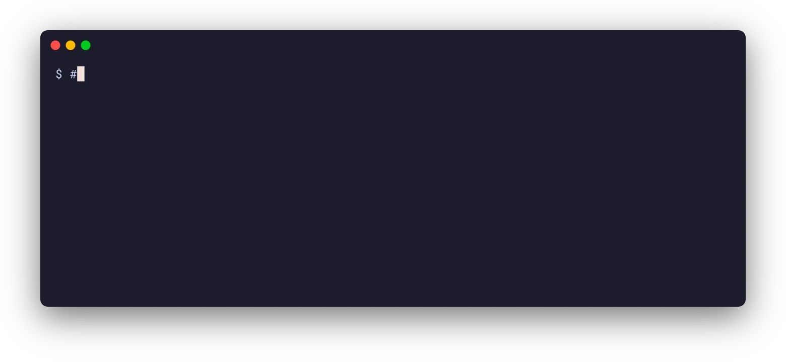

# skills

Claude Code skills I use, written generically enough for anyone else to use.



| Skill | What it does |
| --- | --- |
| [`vhs`](./skills/vhs) | Terminal screenshots and screencasts of real CLI sessions, recorded with [VHS](https://github.com/charmbracelet/vhs) and framed with rounded corners and a drop shadow. |

## Installing

```sh
./scripts/install.sh
```

It symlinks each skill into `~/.claude/skills`, so there's only ever one copy.

## Other skills

| Repo | Skills | What they do |
| --- | --- | --- |
| [voice.md](https://github.com/jedevc/voice.md) | `use-voice`, `build-voice` | Write in your voice from a `VOICE.md`, and build one from your own writing. |
